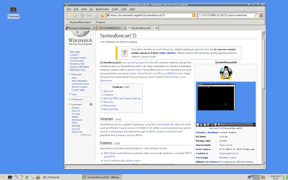
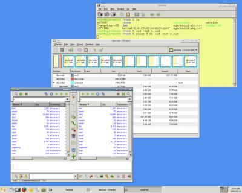

# SystemRescue A Live Workspace for Disk Recovery

When an installed operating system cannot start, a system rescue cd environment provides a separate place to inspect storage and recover files.
SystemRescue is an Arch-based live toolkit; systemrescue linux can run from boot media without installing onto the affected disk.

[](https://system-rescue-cd.github.io/Systemrescue-Linux/)

## Identify the source before choosing an operation

In a systemrescue 13 session, start by distinguishing the affected device from the boot medium and recovery destination.
Match device names with capacity, model, and serial number.
A name such as sda can change after reconnecting hardware or rebooting.

Use lsblk to inspect the available devices and their current mount points:

```bash
lsblk --output NAME,SIZE,MODEL,SERIAL,FSTYPE,MOUNTPOINTS
```

The [lsblk manual](https://man.archlinux.org/man/lsblk.8.en) explains the device tree and explicit output columns.
Record which physical device contains the source data and which device will receive recovered material.
For a failing source, keep it unmounted while creating a raw image.
Avoid filesystem repair on the original when preserving recoverable data is the immediate goal.



## Match the recovery method to the condition

The tools solve different problems, even when the same disk appears in their device lists.
Choose the operation from the condition of the storage and the result you need.

| Situation | Suitable tool family | Result | Main dependency |
| --- | --- | --- | --- |
| Readable files on stable storage | Rsync or a file manager | Selected files and directories | A readable mounted filesystem |
| Read errors on a source device | GNU ddrescue | Raw image and progress map | Separate healthy destination storage |
| Lost partition information | TestDisk | Partition analysis and recovery options | Correct device identification |
| Filesystem metadata unavailable | PhotoRec | Recovered file contents | Separate space for recovered files |

Consult the [SystemRescue tool inventory](https://www.system-rescue.org/System-tools/) for the utilities supplied by the distribution.
An image, a filesystem archive, and a directory copy preserve different kinds of information.
Keep the recovery method and its expected result in the incident notes.

## Preserve readable sectors before investigating damage

For systemrescue data recovery involving read errors, ddrescue can prioritize accessible areas.
Use a new image and mapfile pair for this source.
Assume the source is unmounted and the healthy destination is already mounted at /mnt/recovery with enough free space.

Replace the illustrative by-id device name after checking its identity.
The first command skips scraping; the second enables direct input access and two retry passes.

```bash
ddrescue -n /dev/disk/by-id/ata-SOURCE_DISK /mnt/recovery/source.img /mnt/recovery/source.map
ddrescue -d -r2 /dev/disk/by-id/ata-SOURCE_DISK /mnt/recovery/source.img /mnt/recovery/source.map
```

The [ddrescue manual](https://man.archlinux.org/man/ddrescue.1.en) documents the input, output, and mapfile arguments.
Keep the same source, image, and mapfile association when resuming.
Direct access depends on device support and sector alignment; adapt the retry pass if it is unsuitable.
The mapfile records recovery progress, including areas that remain unreadable.
Retain the original image and perform filesystem experiments on a separate working copy.

## Copy readable files to healthy storage

For stable storage, a file-level copy can be more useful than a whole-device image.
Assume /mnt/source is already mounted read-only and /mnt/recovery is on a different, healthy device.
Use a new destination directory on a Linux filesystem that supports the metadata being preserved.

Preview the transfer, inspect its paths, and then perform the copy:

```bash
rsync -aHAXn --numeric-ids /mnt/source/ /mnt/recovery/files/
rsync -aHAX --numeric-ids --info=progress2 /mnt/source/ /mnt/recovery/files/
```

The trailing source slash copies its contents into the destination.
These options preserve common Linux metadata, hard links, ACLs, and extended attributes where supported.
Matching destination files can be updated; choose a separate destination for each recovery attempt.
The [rsync manual](https://rsync.samba.org/ftp/rsync/rsync.1) describes archive mode and the additional metadata options.

Open representative recovered files before treating the copy as complete.
A completed transfer is distinct from proof that every source file was readable.



## Compare the supplied Clonezilla utilities

The Clonezilla device helper [ocs-blk-dev-info](bin/ocs-blk-dev-info) generates JSON from block-device information.
[ocs-scan-disk](bin/ocs-scan-disk) displays kernel messages about removable disks.
[ocs-pt-size-from-sf](bin/ocs-pt-size-from-sf) reads partition sizes from an sfdisk dump.
[ocs-pt-512-4k-convert](bin/ocs-pt-512-4k-convert) converts partition-table dump values between sector sizes.
These utilities provide reference material for device and partition handling.

Clonezilla release helpers include [ocs-live-ver](bin/ocs-live-ver) and [get-latest-ocs-live-ver](bin/get-latest-ocs-live-ver).
[ocs-get-nic-fw-lst](bin/ocs-get-nic-fw-lst) generates a network firmware list inside a chroot.
[ocs-socket](bin/ocs-socket) sends a message to another host through a socket.
[gen-torrent-from-ptcl](bin/gen-torrent-from-ptcl) creates torrent metadata from Partclone helper data.

### Configuration and operation hooks

[drbl-ocs.conf](conf/drbl-ocs.conf) contains Clonezilla defaults, including image-volume settings.
The pre-operation hook note is [00-readme.txt](prerun/ocs/00-readme.txt).
The post-operation hook note is [00-readme.txt](postrun/ocs/00-readme.txt).
Their comments describe the Clonezilla option required to enable those hooks.

### Packaging references

[Makefile](Makefile) defines Clonezilla installation targets, and [clonezilla.spec](clonezilla.spec) defines RPM packaging.
[00-notes.txt](toolbox/00-notes.txt) outlines the package preparation process.
[packit.sh](toolbox/packit.sh) assembles the source archive.
[make-deb.sh](toolbox/make-deb.sh) and [make-rpm.sh](toolbox/make-rpm.sh) prepare distribution packages.
[makeit.sh](toolbox/makeit.sh) orchestrates packaging steps.
[LICENSE](LICENSE) contains the GPL version 2 license text supplied with this snapshot.

## Make rescue media preferences repeatable

A systemrescue bootable usb can carry YAML preferences when its filesystem is writable.
For example, the following configuration requests a graphical desktop and an integrity check at boot.

```yaml
global:
  dostartx: true
  checksum: true
```

Place a configuration such as 200-recovery.yaml in the boot medium's sysrescue.d directory.
The [configuration manual](https://www.system-rescue.org/manual/Configuring_SystemRescue/) requires the .yaml extension and explains merge order.
Files are processed in lexicographic order; boot command-line options take precedence.
A raw-written ISO does not automatically provide a writable filesystem for editing these preferences.

## Keep a useful recovery record

Retain device identities, the recovery command, the destination path, and any mapfile with the case notes.
Separate observations from changes made during later repair attempts.
Confirm that important recovered documents open before deciding what to do with the original storage.

The uploaded files are a partial Clonezilla snapshot; SystemRescue's own build sources are absent.
The linked Clonezilla helpers are reference material from a separate project, not SystemRescue commands or a complete rescue image.
SystemRescue's own build instructions and source links are documented in its [source guide](https://www.system-rescue.org/manual/Building_SystemRescue_from_Source/).

## Related Search Terms

system rescue cd, systemrescue linux, systemrescue 13, systemrescue data recovery, systemrescue bootable usb, linux, live-usb, data-recovery, disaster-recovery, disk-imaging, backup, filesystems, partitioning, system-administration, arch-linux
